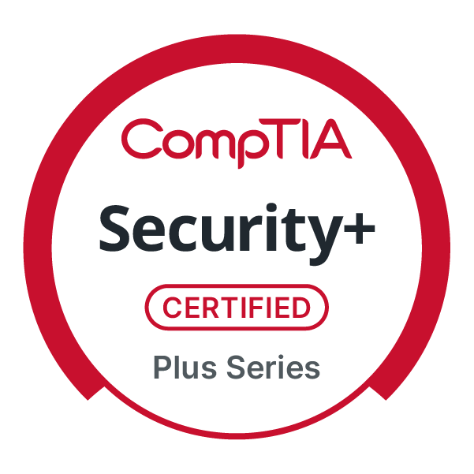
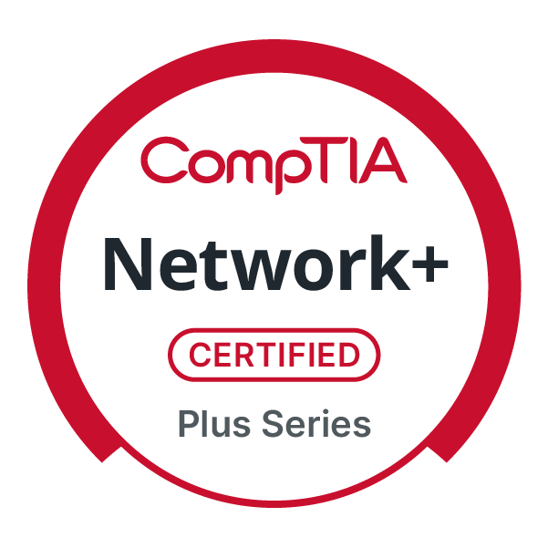
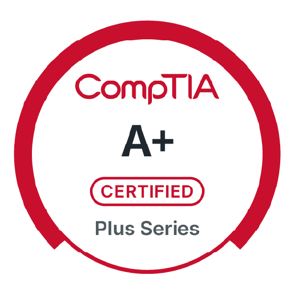
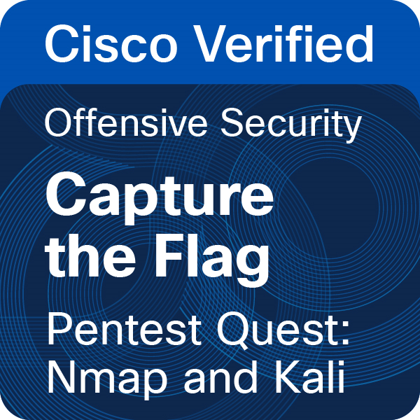
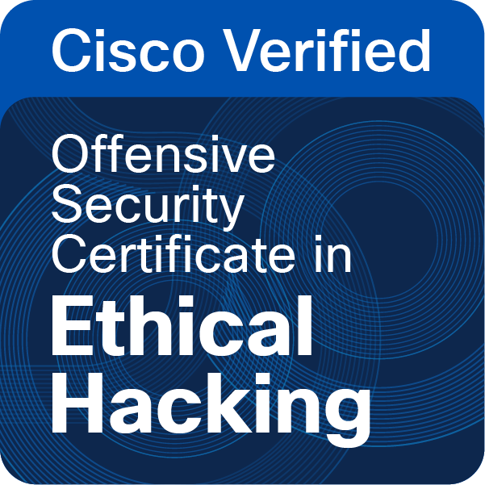
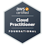

# About Me  

I'm a  **web application penetration tester** and **full stack web developer** passionate about building applications that are not only innovative but also **secure against modern threats**.  

🎓 I completed a **Full Stack Web Development Bootcamp** at the **University of New Brunswick**, hold the **Meta Front-End Developer Professional Certificate**, and am currently expanding my backend expertise through **Meta’s Web Development Professional Certificate**.  

🔐 My focus is on the **intersection of secure software development and cybersecurity**, with an emphasis on **web application security**. I actively train on **TryHackMe** and **HackTheBox**, sharpening my penetration testing, ethical hacking, and defensive security skills.  

---

## Tech Stack

---

## 🚀 Technical Focus  

- **Full Stack Development**: Python, Django, JavaScript, React, SQL, MongoDB  
- **Cloud & DevOps**: AWS (Certified Cloud Practitioner), Docker, CI/CD  
- **Cybersecurity**: Web application security, penetration testing, network defense  

---

## 🎓 Certifications  

---

## 🌱 Currently Exploring  

- 🔐 Web application penetration testing methodologies (OWASP Top 10, Burp Suite, etc.)  
- 🛠 Django security best practices to harden applications I build  
- ☁️ Secure cloud deployments on AWS  
- 📊 Advanced database security and access management  

---

## 🏆 Achievements  

- Built and deployed multiple **full stack projects** integrating front-end, back-end, and cloud services  
- Designed apps with a focus on **security-first architecture**  
- Active learner in cybersecurity labs and challenges (**THM, HTB**)  

---

## 📬 Get in Touch  

Thank you for visiting my profile! I’m always open to connecting with developers, ethical hackers, and cybersecurity professionals. Let’s collaborate to build and secure the next generation of web applications. 🚀  

- Let’s connect and talk tech! Reach me on [linkedIn](https://www.linkedin.com/in/kirill-lazutin-9b18a115b/)
